<p align="center">
  
</p>

<h1 align="center">DeepClean</h1>

<p align="center">
  A free, open-source Mac cleaner that can't delete anything for good.
</p>

---

DeepClean finds the caches, logs and build junk that pile up on a Mac — especially a developer's Mac — and shows you what's safe to clear.

- **Scanning is read-only.** It looks; it changes nothing.
- **Cleaning moves items to the Trash.** Nothing is deleted permanently. Changed your mind? Put it back from the Trash.
- **No network.** No accounts, no analytics, no "upgrade to Pro". DeepClean's code makes no network requests — search the source for yourself.
- **Fixed allow-list.** It only ever looks at the folders listed below, all inside your home folder, and re-checks every path against that list before moving it.
- **Open source.** Read the code, then build exactly what you read.

## What it looks at

| Category | Location (in your home folder) | Default |
| --- | --- | --- |
| Application Caches | `Library/Caches` | Safe |
| Application Logs | `Library/Logs` | Safe |
| Xcode Derived Data | `Library/Developer/Xcode/DerivedData` | Safe |
| npm Cache | `.npm/_cacache` | Safe |
| uv Cache | `.cache/uv` | Safe |
| ML Model Caches | `.cache/torch`, `.cache/mlx`, `.cache/whisper` | Safe |
| Claude Code Logs | `.claude/debug`, `.claude/shell-snapshots` | Safe |
| Cursor Caches | `Library/Application Support/Cursor/{Cache,CachedData,Code Cache,GPUCache,logs}` | Safe |
| Hugging Face Models | `.cache/huggingface/hub` | Review |
| Ollama Models | `.ollama/models` | Review |
| LM Studio Models | `.lmstudio/models`, `.cache/lm-studio/models` | Review |
| Trash | `.Trash` | Shown only — empty it from Finder |

**Safe** means the app rebuilds or re-downloads it for free. **Review** means it's large and slow to download again, so "Select safe items" leaves it unticked. Nothing is ever selected until you choose it. Anything a running app has open right now (checked with `lsof`) is flagged before you clean.

### Inventory tab

The Inventory tab lists what's installed — Homebrew formulas and casks (including orphaned dependencies), apps, global npm / pipx / cargo tools, and old Node, Python and Ruby versions — with their sizes. It never uninstalls anything: each item has the exact command (for example `brew uninstall --cask <name>`), which DeepClean copies to your clipboard for you to run yourself.

## Install (build from source)

Building it yourself means you run exactly the code you can read here, and macOS won't show an "unidentified developer" warning for an app you built.

**You need:** macOS, [Xcode Command Line Tools](https://developer.apple.com/xcode/resources/), [Rust](https://rustup.rs) and [Node.js](https://nodejs.org) 18 or newer.

```sh
xcode-select --install          # skip if already installed
curl --proto '=https' --tlsv1.2 -sSf https://sh.rustup.rs | sh   # skip if you have Rust

git clone https://github.com/faizanmohiuddin482/deepclean.git
cd deepclean
npm install
npm run tauri build -- --bundles app
```

The app is built to `src-tauri/target/release/bundle/macos/DeepClean.app`. Drag it into your Applications folder.

To run it in development mode instead: `npm run tauri dev`.

## How it's built

[Tauri 2](https://tauri.app) with a Rust backend and a plain TypeScript frontend (no framework).

- `src-tauri/src/cleaner.rs` — the scan, the allow-list (`CATEGORIES`) and the move-to-Trash logic
- `src-tauri/src/inventory.rs` — the read-only inventory
- `src/main.ts`, `src/styles.css`, `index.html` — the UI

## Contributing

Issues and pull requests are welcome. If you'd like DeepClean to look at a new folder, open an issue with the path, what creates it, and whether it's safe to clear.

## License

[MIT](LICENSE)
